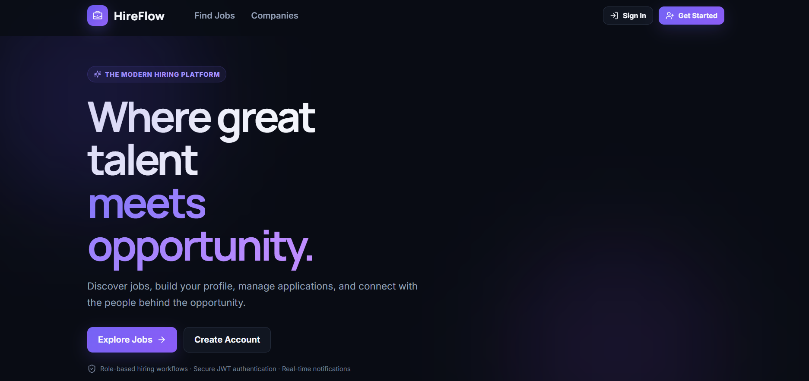

# HireFlow – Job Portal

A full-stack job portal that connects job seekers with employers. Employers post and manage openings, and candidates browse jobs and apply. The backend is a REST API built with Django REST Framework, and the frontend is a React single-page app.



> **Drafting note:** items marked `TODO` are things I couldn't confirm from the repo. Check them against your code and delete this note before committing.

## Features

- User registration and login for **job seekers** and **employers** (TODO: confirm roles and auth method, e.g. JWT or token)
- Employers: create, edit and delete job listings; view applicants (TODO)
- Job seekers: browse and search jobs, apply, track applications (TODO)
- REST API with a separate React client

## Tech Stack

| Layer    | Technology                                   |
|----------|----------------------------------------------|
| Backend  | Python, Django, Django REST Framework        |
| Frontend | React (TODO: Vite or CRA, UI library)        |
| Database | TODO: MySQL / PostgreSQL / SQLite            |
| Auth     | TODO: JWT (SimpleJWT) / Token / Session      |

## Project Structure

```
Job_Portal/
├── backend/        # Django + DRF API
├── frontend/       # React client
├── hireflow.png    # Project screenshot
└── .gitignore
```

## Getting Started

### Prerequisites

- Python 3.10+
- Node.js 18+ and npm
- A database server if not using SQLite (TODO)

### 1. Clone the repository

```bash
git clone https://github.com/AbhinAshok/Job_Portal.git
cd Job_Portal
```

### 2. Backend setup

```bash
cd backend
python -m venv venv

# Windows (Git Bash)
source venv/Scripts/activate
# macOS / Linux
# source venv/bin/activate

pip install -r requirements.txt   # TODO: confirm file exists
```

Create a `.env` file in `backend/` (TODO: match the variable names your settings use):

```env
SECRET_KEY=your-secret-key
DEBUG=True
DB_NAME=jobportal
DB_USER=your-db-user
DB_PASSWORD=your-db-password
DB_HOST=localhost
DB_PORT=3306
```

Run migrations and start the server:

```bash
python manage.py migrate
python manage.py createsuperuser
python manage.py runserver
```

The API runs at `http://127.0.0.1:8000/`.

### 3. Frontend setup

```bash
cd frontend
npm install
npm run dev      
```

The app runs at `http://localhost:5173/` (Vite) or `http://localhost:3000/` (CRA).

Point the frontend at the API (TODO: confirm variable name):

```env
VITE_API_URL=http://127.0.0.1:8000/api
```

Make sure the frontend origin is allowed in the backend's CORS settings.

## API Overview

TODO: list your main endpoints, for example:

| Method | Endpoint               | Description              |
|--------|------------------------|--------------------------|
| POST   | `/api/auth/register/`  | Register a new user      |
| POST   | `/api/auth/login/`     | Log in                   |
| GET    | `/api/jobs/`           | List jobs                |
| POST   | `/api/jobs/`           | Create a job (employer)  |
| POST   | `/api/jobs/<id>/apply/`| Apply to a job           |

